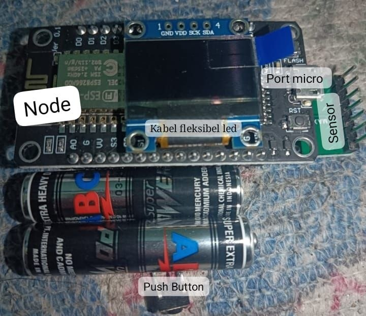
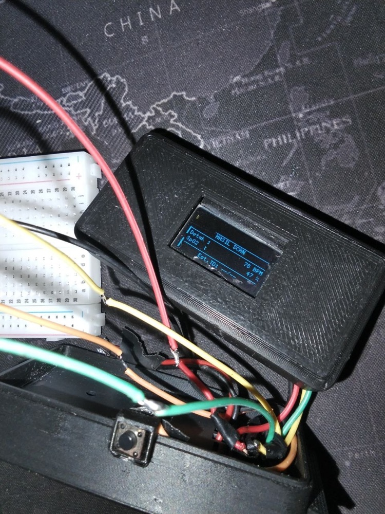

# ❤️ JamSehat v4.1 — Smart Health Clock

> **Jam pintar berbasis IoT yang memantau detak jantung (HR) dan saturasi oksigen darah (SpO₂) secara real-time, dilengkapi tampilan OLED dan akses web via Wi-Fi hotspot.**

[](https://www.espressif.com/)
[](https://www.maximintegrated.com/)
[](https://github.com/olikraus/u8g2)
[](https://www.arduino.cc/)
[](https://www.yazid-bustomi.my.id/)

Proyek freelance: perangkat dirancang, dirakit, dan diprogram dari awal, mulai dari pemilihan komponen, wiring, firmware, sampai casing cetak 3D.

---

## 📸 Dokumentasi

<table>
  <tr>
    <td width="50%" align="center">
      <br>
      <sub><b>Komponen sebelum dirakit.</b> NodeMCU ESP8266 dengan OLED, sensor MAX30102, port micro USB, push button, dan baterai.</sub>
    </td>
    <td width="50%" align="center">
      <br>
      <sub><b>Prototipe dalam casing cetak 3D</b> saat pengujian, menampilkan layar HASIL SCAN.</sub>
    </td>
  </tr>
</table>

| Label di foto | Komponen | Fungsi |
|---------------|----------|--------|
| Node | NodeMCU ESP8266 (ESP-12E) | Otak perangkat: jam NTP, pembacaan sensor, hotspot dan web server |
| Kabel fleksibel LED | Konektor OLED | Menghubungkan layar OLED ke bus I2C |
| Port micro | Micro USB | Upload program dan catu daya saat pengembangan |
| Sensor | MAX30102 | Membaca detak jantung dan SpO₂ dari ujung jari |
| Push Button | Tactile switch (D5) | Mulai scan dan membangunkan perangkat dari sleep |

---

## 🌟 Fitur Utama

| Fitur | Keterangan |
|-------|------------|
| ⏰ **Jam Real-Time** | Sinkronisasi NTP (WIB GMT+7), tampil di OLED |
| ❤️ **Detak Jantung** | Pengukuran BPM dengan algoritma beat detection |
| 🩸 **SpO₂** | Saturasi oksigen darah (%) menggunakan PPG |
| 📶 **Hotspot Wi-Fi** | Soft AP "JamSehat" — akses web tanpa internet |
| 🌐 **Dashboard Web** | Update otomatis tiap 3 detik + riwayat 10 scan |
| 💤 **Mode Sleep** | Hemat daya — OLED & AP mati setelah 1 menit idle |
| 📊 **History Scan** | Menyimpan 10 hasil scan terakhir (ringbuffer) |

---

## 🔧 Spesifikasi Hardware

### 1. NodeMCU ESP8266

| Spesifikasi | Detail |
|-------------|--------|
| **Mikrokontroler** | Tensilica 32-bit RISC CPU Xtensa LX106 |
| **Kecepatan Clock** | 80 MHz / 160 MHz |
| **Tegangan Operasi** | 3.3V |
| **Wi-Fi** | 2.4 GHz (802.11 b/g/n), terintegrasi |
| **Flash Memory** | 4 MB |
| **RAM** | 64 KB instruksi + 96 KB data SRAM |
| **GPIO** | 17 pin (PWM, I2C, SPI, UART) |
| **ADC** | 1 pin analog (resolusi 10-bit) |
| **USB** | CH340G atau CP2102 (pemrograman langsung) |

### 2. Sensor MAX30102

| Spesifikasi | Detail |
|-------------|--------|
| **Fungsi** | Detak jantung (BPM) + saturasi oksigen (SpO₂) |
| **Metode** | Photoplethysmography (PPG) |
| **Catu Daya** | 1.8V (chip) / 3.3V–5.0V (LED) |
| **Antarmuka** | I2C (Alamat: `0xAE` Write / `0xAF` Read) |
| **LED Merah** | ≈ 660 nm (deteksi darah rendah oksigen) |
| **LED IR** | ≈ 880–940 nm (deteksi hemoglobin kaya oksigen) |
| **FIFO Buffer** | 32 sample |
| **Sensor Suhu** | -40°C s/d +85°C (±1°C, kalibrasi SpO₂) |

### 3. OLED 1.3" SH1106

| Spesifikasi | Detail |
|-------------|--------|
| **Resolusi** | 128 × 64 piksel |
| **Driver IC** | SH1106 (atau SSD1306) |
| **Antarmuka** | I2C / IIC |
| **Tegangan** | 3.3V atau 5V DC |
| **Sudut Pandang** | > 160° |
| **Warna** | Biru / Putih / Kuning-Biru |
| **Ukuran Modul** | ~34.5 × 23 mm |
| **Jumlah Pin** | 4 pin (I2C: VCC, GND, SCL, SDA) |

### 4. Push Button (Tactile Switch)

| Spesifikasi | Detail |
|-------------|--------|
| **Tipe** | Momentary (aktif saat ditekan) |
| **Kontak** | NO (Normally Open) |
| **Tegangan** | 3.3V / 5V |
| **Ukuran** | 6×6 mm (umum) |
| **Fungsi** | Mulai scan, wake dari sleep |

---

## 🔌 Wiring / Skema Koneksi

### Tabel Pin

| Komponen | Pin Komponen | Pin NodeMCU | GPIO |
|----------|-------------|-------------|------|
| **OLED SH1106** | SDA | D2 | GPIO4 |
| **OLED SH1106** | SCL | D1 | GPIO5 |
| **OLED SH1106** | VCC | 3V3 | — |
| **OLED SH1106** | GND | GND | — |
| **MAX30102** | SDA | D2 | GPIO4 |
| **MAX30102** | SCL | D1 | GPIO5 |
| **MAX30102** | VCC | 3V3 | — |
| **MAX30102** | GND | GND | — |
| **Push Button** | Pin 1 | D5 | GPIO14 |
| **Push Button** | Pin 2 | GND | — |

> ⚠️ **Catatan:** OLED dan MAX30102 berbagi bus I2C (SDA = D2, SCL = D1). Pastikan alamat I2C tidak konflik.

### Diagram Koneksi

```
NodeMCU ESP8266
 ┌─────────────────────────────────────┐
 │  3V3 ──────────────┬─── VCC (OLED)  │
 │                    └─── VCC (MAX)   │
 │  GND ──────────────┬─── GND (OLED)  │
 │                    ├─── GND (MAX)   │
 │                    └─── GND (BTN)   │
 │  D1  (GPIO5/SCL) ──┬─── SCL (OLED)  │
 │                    └─── SCL (MAX)   │
 │  D2  (GPIO4/SDA) ──┬─── SDA (OLED)  │
 │                    └─── SDA (MAX)   │
 │  D5  (GPIO14) ─────── PIN1 (BTN)    │
 └─────────────────────────────────────┘
```

> 💡 Pull-up internal aktif di D5 (`INPUT_PULLUP`), jadi tidak perlu resistor eksternal.

---

## 📦 Library yang Dibutuhkan

Install via **Arduino IDE Library Manager** atau **PlatformIO**:

| Library | Versi | Keterangan |
|---------|-------|------------|
| `SparkFun MAX3010x Sensor Library` | ≥ 1.1.2 | Driver sensor MAX30102 |
| `U8g2` | ≥ 2.28 | Driver OLED SH1106 |
| `ESP8266WiFi` | Built-in | Wi-Fi & Soft AP |
| `ESP8266WebServer` | Built-in | Web server |
| `time.h` | Built-in | NTP & waktu |

---

## ⚙️ Konfigurasi Kode

Buka file `.ino` dan ubah bagian berikut sebelum upload:

```cpp
// ─── WIFI NTP (untuk sinkronisasi jam saat boot) ──────────
const char* STA_SSID = "NAMA_WIFI_ANDA";   // ← ganti
const char* STA_PASS = "PASSWORD_WIFI";    // ← ganti
const long  GMT_OFFSET = 7 * 3600;         // WIB (UTC+7)

// ─── SOFT AP (hotspot yang dibuat ESP8266) ────────────────
const char* AP_SSID = "JamSehat";          // nama hotspot
const char* AP_PASS = "12345678";          // password hotspot
```

---

## 🚀 Alur Program

```
Boot
 │
 ├── Tampil splash screen "JamSehat v4.1"
 ├── Sambung WiFi STA → Sinkronisasi NTP (jam WIB)
 ├── WiFi STA OFF → Soft AP "JamSehat" ON
 │
 ▼
STATE_CLOCK ──[tombol]──► STATE_SCAN (30 detik)
     ▲                         │
     │                    [selesai scan]
     │                         ▼
     └──────────────── STATE_RESULT (30 detik)
     │
     └──[idle 1 menit]──► STATE_SLEEP (OLED + AP mati)
                               │
                          [tombol]
                               │
                               ▼
                         AP ON → STATE_CLOCK
```

---

## 📱 Akses Dashboard Web

1. Hubungkan HP/laptop ke Wi-Fi **"JamSehat"** (password: `12345678`)
2. Buka browser → ketik: **`http://192.168.4.1`**
3. Dashboard menampilkan:
   - ❤️ Detak Jantung (BPM)
   - 🩸 Saturasi Oksigen SpO₂ (%)
   - 📶 Kualitas sinyal sensor
   - 🕐 Jam real-time
   - 📋 Riwayat 10 scan terakhir
4. Data diperbarui **otomatis tiap 3 detik**

> Endpoint JSON tersedia di: `http://192.168.4.1/data`

---

## 📋 Cara Upload Program

### Persiapan Arduino IDE

1. Tambahkan board ESP8266 di **Preferences → Additional Board Manager URLs:**
   ```
   http://arduino.esp8266.com/stable/package_esp8266com_index.json
   ```
2. Install board: **Tools → Board Manager → esp8266** (by ESP8266 Community)
3. Install semua library di tabel [Library yang Dibutuhkan](#-library-yang-dibutuhkan)

### Upload

1. Pilih board: **Tools → Board → NodeMCU 1.0 (ESP-12E Module)**
2. Pilih port COM yang sesuai
3. Upload speed: **115200**
4. Klik **Upload** ✓

---

## 🔬 Cara Penggunaan

1. **Nyalakan** perangkat — tunggu sinkronisasi jam (±10 detik)
2. Layar OLED menampilkan **jam & tanggal** (STATE_CLOCK)
3. **Tempelkan jari** ke sensor MAX30102
4. **Tekan tombol** di D5 → mulai scan 30 detik (STATE_SCAN)
5. Lihat progres bar & nilai HR/SpO₂ secara live
6. Setelah 30 detik → **HASIL SCAN** ditampilkan 30 detik
7. Kembali otomatis ke tampilan jam

> 💡 **Tips:** Tempelkan jari dengan tekanan sedang, jangan terlalu keras atau terlalu ringan. Sinyal terbaik = "great" (4 bar penuh).

---

## 📊 Indikator Kualitas Sinyal

| Bar | Label | Keterangan |
|-----|-------|------------|
| ░░░░ | no finger | Jari tidak terdeteksi |
| ▓░░░ | bad | Sinyal buruk, geser jari |
| ▓▓░░ | fair | Sinyal cukup |
| ▓▓▓░ | good | Sinyal baik |
| ▓▓▓▓ | great | Sinyal sangat baik ✓ |

---

## 📁 Struktur File

```
smart-health-clock/
├── smart-health-clock.ino   # Kode utama Arduino
├── docs/
│   └── images/              # Foto dokumentasi perangkat
└── README.md                # Dokumentasi ini
```

> Arduino IDE meminta file `.ino` berada di folder dengan nama yang sama. Clone repo ini apa adanya, lalu buka `smart-health-clock/smart-health-clock.ino`.

---

## 🛠️ Troubleshooting

| Masalah | Solusi |
|---------|--------|
| OLED tidak menyala | Cek koneksi SDA/SCL, coba scan I2C address |
| "SENSOR ERROR" di layar | Cek kabel MAX30102, pastikan 3.3V terhubung |
| Jam tidak sinkron | Pastikan SSID/password WiFi benar di kode |
| SpO₂ selalu -- | Tunggu warmup 5 detik, perbaiki posisi jari |
| Web tidak bisa dibuka | Pastikan HP terhubung ke Wi-Fi "JamSehat" |
| Hotspot tidak muncul | Reset perangkat, cek di Serial Monitor |

---

## 📝 Catatan Versi

### v4.1 (Current)
- ✅ Jam lebih kecil (font `fub20` → `fub17`)
- ✅ Halaman hasil scan lebih terpusat
- ✅ Threshold IR diturunkan: `50000` → `30000` (mendukung casing ~1mm)
- ✅ Pulse amplitude naik ke `0x3F` untuk sinyal lebih kuat
- ✅ Hotspot **selalu ON** kecuali mode sleep
- ✅ History 10 scan terakhir di dashboard web

---

## 👨‍💻 Tentang Proyek

JamSehat adalah proyek freelance di bidang **IoT kesehatan (health IoT)** dengan komponen terjangkau. Perangkat ini menggabungkan jam digital dan pemantau kesehatan sederhana dalam satu unit kecil yang hasilnya bisa dilihat dari smartphone.

Pekerjaan yang saya kerjakan:

- Pemilihan komponen dan wiring (ESP8266, MAX30102, OLED, push button)
- Firmware Arduino: jam NTP, pembacaan HR/SpO₂ dengan filter dan indikator kualitas sinyal, mode sleep
- Hotspot Wi-Fi dengan dashboard web dan endpoint JSON
- Perakitan ke dalam casing cetak 3D dan pengujian

Dibuat oleh **Akhmad Yazid Bustomi** — [yazid-bustomi.my.id](https://www.yazid-bustomi.my.id/)

> ⚠️ **Disclaimer:** Perangkat ini **bukan alat medis** dan tidak menggantikan pemeriksaan oleh tenaga kesehatan profesional. Hasil pengukuran digunakan untuk keperluan edukasi dan eksperimen.

---

## 📄 Lisensi

Proyek ini bersifat open-source untuk keperluan edukasi dan non-komersial.

---

*Made with ❤️ using ESP8266 + MAX30102 + Arduino*
